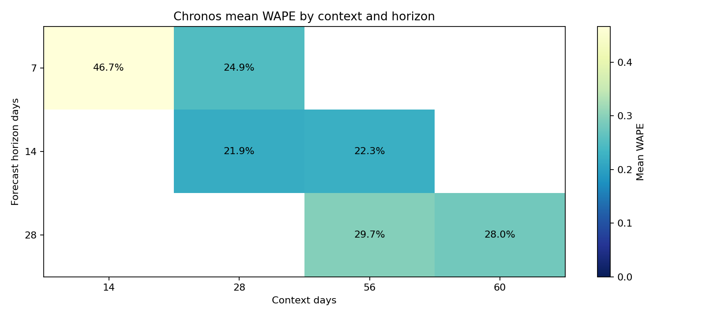

# Chronos 입력 기간·예측 기간 소규모 평가

UCI Online Retail II 일별 순상품매출 시계열과
`chronos-online-retail-v0.1` 체크포인트를 사용해, 예측 시 모델에
보여주는 과거 매출 기간과 예측 기간의 조합을 비교한 결과입니다.

> 이 실험은 체크포인트를 새로 학습한 결과가 아니라, 이미 학습된 동일한
> Chronos 체크포인트의 입력 문맥 길이를 바꿔 평가한 롤링 백테스트입니다.

## 실험 조건

- 데이터: UCI Online Retail II 일별 순상품매출
- 모델: `chronos-online-retail-v0.1`
- Fold: 2
- 샘플 수: 20
- 시드: 42
- 장치: CPU
- 선택 규칙: 최저 평균 WAPE와 2%p 이내인 경우 가장 짧은 입력 기간

## 결과

| 예측 기간 | 입력 기간 | 평균 WAPE | 해석 |
|---:|---:|---:|---|
| 7일 | 14일 | 46.7% | 오차가 크게 나타남 |
| 7일 | 28일 | 24.9% | 14일 입력보다 크게 개선 |
| 14일 | 28일 | **21.9%** | 현재 소규모 평가의 최저 WAPE |
| 14일 | 56일 | 22.3% | 28일 입력과 유사 |
| 28일 | 56일 | 29.7% | 14일 예측보다 오차 증가 |
| 28일 | 60일 | 28.0% | 56일 입력보다 다소 개선 |

이 예비 결과를 기반으로 MVP는 **최근 28일 입력 → 다음 14일 예측**을
기본값으로 사용합니다. 단, 2개 Fold만 사용한 소규모 결과이므로 운영
설정을 확정하기 전 10-Fold 전체 평가와 실제 국내 매장 데이터 검증이
필요합니다.



## 파일

- `summary_metrics.csv`: 조건별 평균·표준편차·최악 지표
- `fold_metrics.csv`: Fold·조건별 개별 지표
- `predictions.csv`: 날짜별 실제값과 q10·q50·q90 예측
- `recommendations.csv`: 선택 규칙에 따른 예측 기간별 권장 문맥
- `run_manifest.json`: 경로·비밀정보를 제거한 재현 설정

## 재실행

```bash
chronos-sales context-horizon-benchmark --smoke --device cpu
```

전체 10-Fold 평가:

```bash
chronos-sales context-horizon-benchmark --device cpu
```
